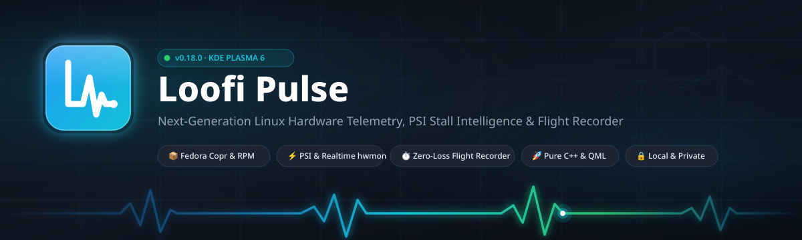
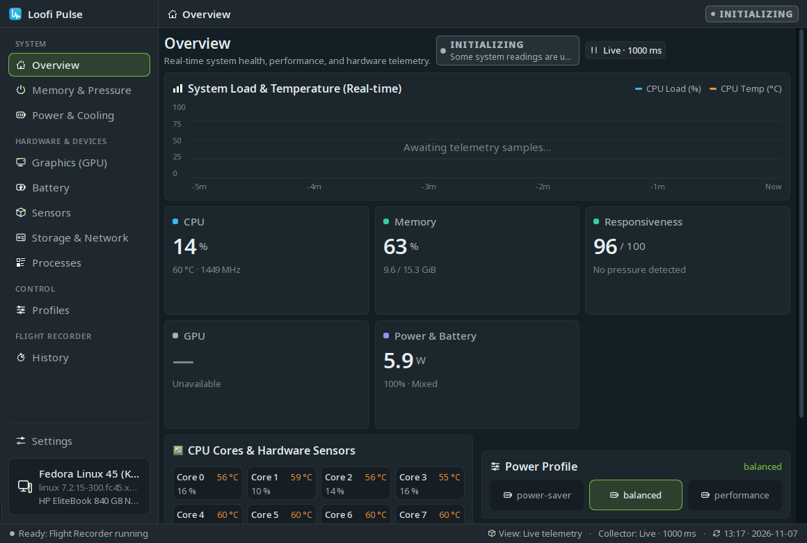
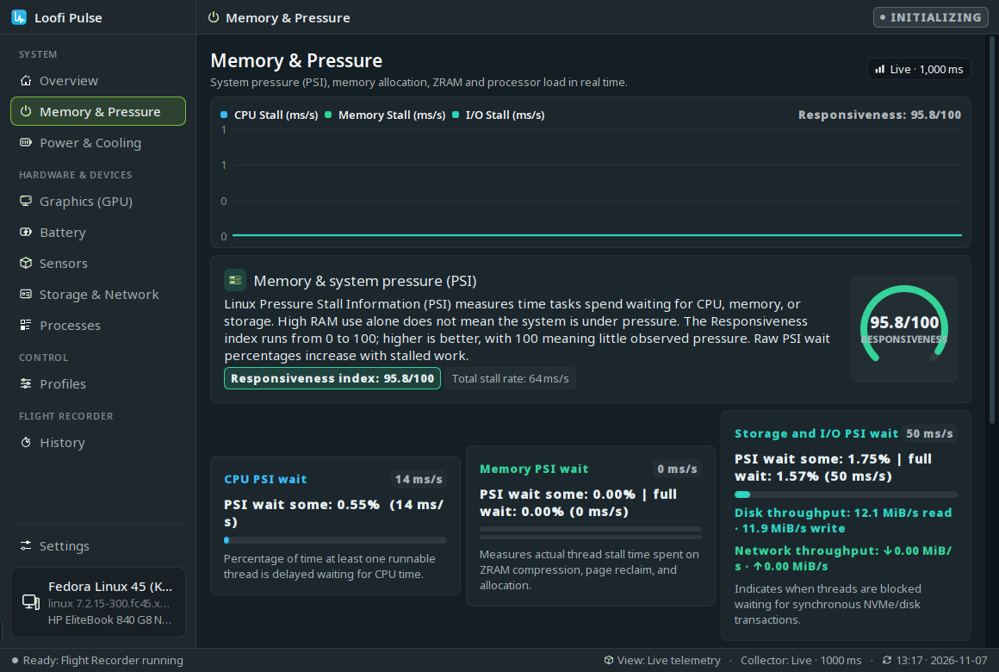
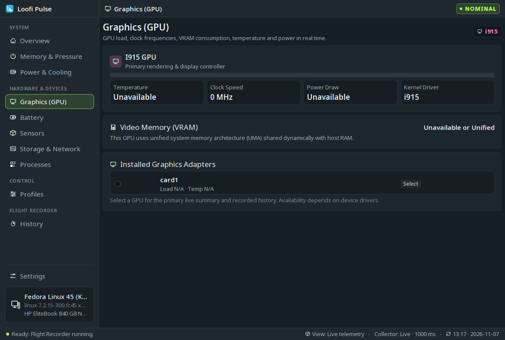
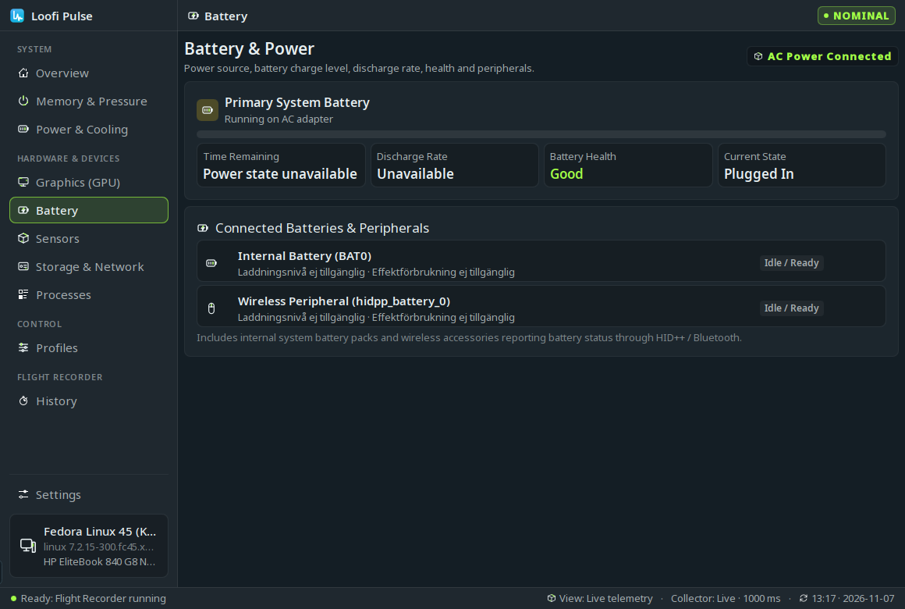
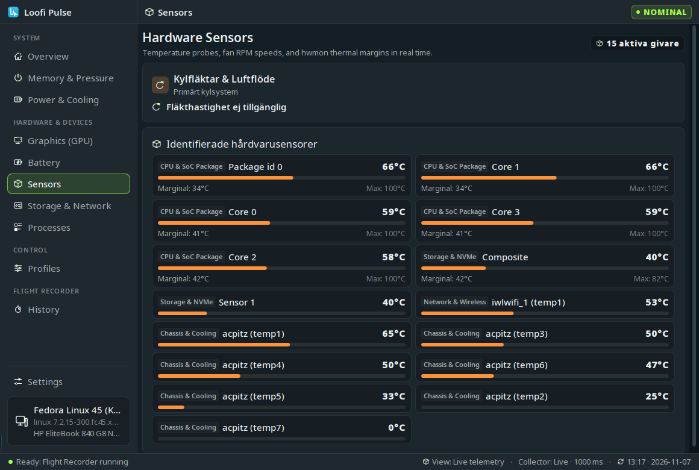
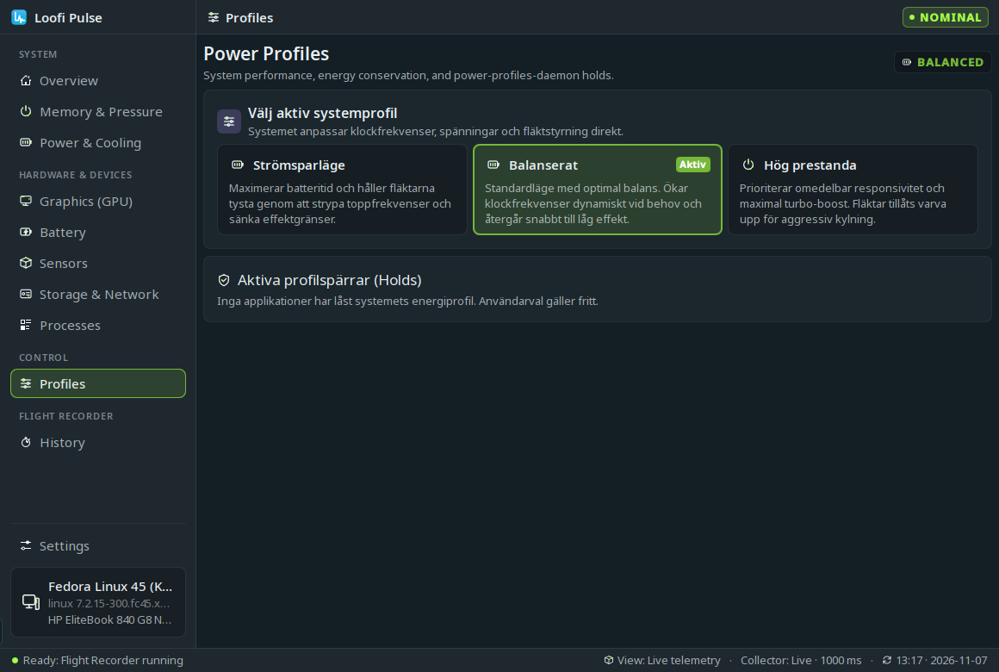
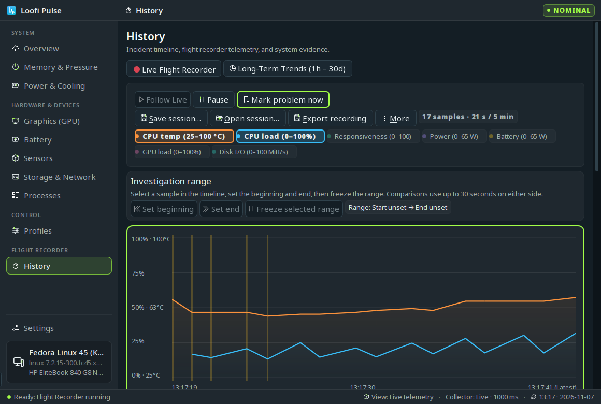
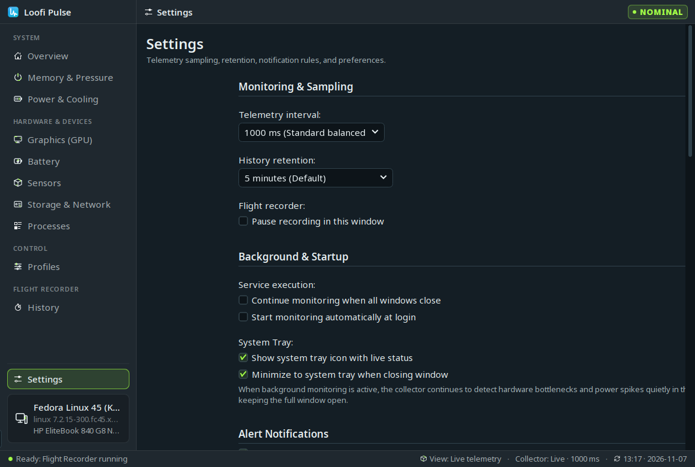

<div align="center">



# Loofi Pulse

**Next-Generation Linux Hardware Telemetry, PSI Stall Intelligence & Flight Recorder for KDE Plasma 6**

[](https://copr.fedorainfracloud.org/coprs/loofitheboss/plasma-hardware-pulse/)
[](https://kde.org/plasma-desktop/)
[](https://www.qt.io/)
[](LICENSE)
[](tests/)

</div>

---

## 🌟 Overview

**Loofi Pulse** is a lightweight, local-first system telemetry and hardware health suite designed specifically for **KDE Plasma 6** and **Fedora Linux**. Combining a high-performance Kirigami desktop application with an interactive desktop panel widget, Loofi Pulse delivers actionable diagnostic insights into processor performance, Linux Pressure Stall Information (PSI), thermals, discrete graphics, power envelopes, and hardware throttling without synthetic scores, bloat, or AI-generated placeholders.

### Why Loofi Pulse?

- **Real-Time Linux Kernel Pressure (PSI)**: Instant visibility into CPU, memory, and I/O starvation stalls (`some` / `full avg10`) via `/proc/pressure`.
- **Zero-Loss Flight Recorder**: Continuous 5–30 minute in-memory circular telemetry buffer with an interactive time scrubber to investigate stutters after they occur.
- **Root-Cause Causal Engine**: Deterministically identifies the exact process and resource bottleneck causing system sluggishness.
- **Dedicated Hardware Hubs**: Modular deep-dive pages for GPU execution units & VRAM, battery flow & peripherals, hwmon sensor grids, and energy profiles.
- **Zero Elevated Privileges**: Runs entirely in user-space with standard sysfs and D-Bus interfaces.
- **Multi-Language Support**: English by default, with complete native Swedish localization (`sv`) and system locale detection.

---

## 📸 Screenshots Showcase

<div align="center">

| Overview Command Center | Linux Memory & PSI Pressure |
| :---: | :---: |
|  |  |

| Graphics (GPU) Telemetry | Battery & Peripherals |
| :---: | :---: |
|  |  |

| Hardware Sensor Grid (hwmon) | Power Profiles Daemon (PPD) |
| :---: | :---: |
|  |  |

| Flight Recorder & Incident History | Preferences & Language Hub |
| :---: | :---: |
|  |  |

</div>

---

## 🚀 Installation

### Option 1: Fedora Copr (Recommended)

Loofi Pulse is officially packaged and continuously built for Fedora 44 and Fedora 45 x86_64:

```bash
# Enable the Fedora Copr repository
sudo dnf copr enable loofitheboss/plasma-hardware-pulse

# Install Loofi Pulse application, service daemon, and Plasma 6 widget
sudo dnf install plasma-hardware-pulse

# Launch Loofi Pulse
loofi-pulse
```

### Option 2: Pre-Built RPM Release

Download the matching `.rpm` and checksum file from [GitHub Releases](https://github.com/loofiboss-bit/plasma-hardware-pulse/releases):

```bash
sha256sum --check --ignore-missing SHA256SUMS
sudo dnf install ./plasma-hardware-pulse-0.18.0-1.fc45.x86_64.rpm
loofi-pulse
```

---

## 📖 User Guide & Architecture

Comprehensive documentation is available in the [`docs/`](docs/) directory:

- 📘 **[Complete User Guide](docs/user-guide.md)**: In-depth walkthrough of every page, PSI pressure metrics, thermal velocity, battery health calculation, and keyboard shortcuts.
- 🏗️ **[System Architecture](docs/public-readiness.md)**: Details on the shared D-Bus user daemon (`com.github.loofi.hardwarepulse.Collector1`), in-memory flight recorder buffer, and optional SQLite persistent aggregate database.

---

## ⌨️ Keyboard Shortcuts

| Shortcut | Action |
| :--- | :--- |
| `Ctrl+1` / `Alt+1` | Jump to **Overview** |
| `Ctrl+2` / `Alt+2` | Jump to **Flight Recorder / History** |
| `Ctrl+3` / `Alt+3` | Jump to **Memory & Pressure** |
| `Ctrl+4` / `Alt+4` | Jump to **Power & Cooling** |
| `Ctrl+5` | Jump to **Processes** |
| `Ctrl+6` | Jump to **Storage & Network** |
| `Ctrl+,` / `Ctrl+Alt+S` | Open **Settings** |
| `Ctrl+O` | Open saved session file (`.pulse-session`) |
| `Ctrl+S` | Export current incident report / session |
| `F1` / `Ctrl+?` | Show Keyboard Shortcuts cheat sheet |

---

## 🛠️ Build and Verify from Source

### Build Prerequisites

Ensure all required development libraries are installed on your Fedora system:

```bash
sudo dnf install cmake extra-cmake-modules gcc-c++ dbus-daemon \
    kf6-kcmutils-devel kf6-kconfig-devel kf6-kcoreaddons-devel kf6-kcrash-devel \
    kf6-ki18n-devel kf6-kirigami-devel kf6-knotifications-devel kf6-kwindowsystem-devel \
    kf6-kpackage-devel kf6-qqc2-desktop-style libplasma-devel \
    qt6-qtbase-devel qt6-qtdeclarative-devel qt6-qttools-devel libappstream-glib
```

### Build & Test Suite

```bash
# Configure build directory
cmake -S . -B build -DBUILD_TESTING=ON -DBUILD_LIVE_HARDWARE_TESTS=OFF \
    -DCMAKE_BUILD_TYPE=RelWithDebInfo -DCMAKE_INSTALL_PREFIX=/usr

# Compile all binaries and plugins
cmake --build build --parallel $(nproc)

# Execute the complete automated test suite (84 tests)
ctest --test-dir build --output-on-failure

# Install to system
sudo cmake --install build
```

---

## 🔒 Privacy & Data Storage Guarantee

1. **Read-Only Process Radar**: Process inspection identifies CPU/RAM/Disk hogs for diagnostic triage only. Loofi Pulse never modifies, attaches debuggers to, or kills processes directly; it delegates process management to the official KDE System Monitor.
2. **Zero Cloud Telemetry**: All sampling, analysis, and storage remain strictly on your local machine. No analytics or phone-home requests are made.
3. **Privacy-Preserving History**: The persistent long-term history SQLite database records only 1-minute numerical performance aggregates (min, avg, max) for CPU, GPU, memory, disks, and thermals. Process identities, command lines, window titles, and PIDs are **never stored** in the persistent database.

---

## 📄 License

- **Code & Core Engine**: GNU General Public License v3.0 ([GPL-3.0-or-later](LICENSE))
- **AppStream Metadata & Documentation Assets**: Creative Commons Zero 1.0 Universal ([CC0-1.0](packaging/com.github.loofi.hardwarepulse.metainfo.xml))
- Copyright © 2026 Loofi Boss & Contributors.
