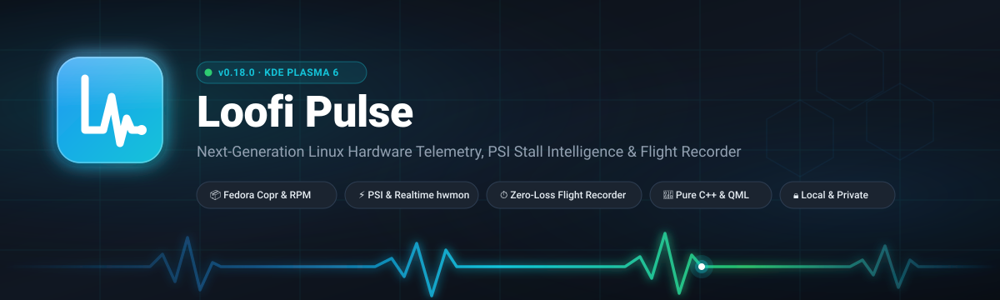
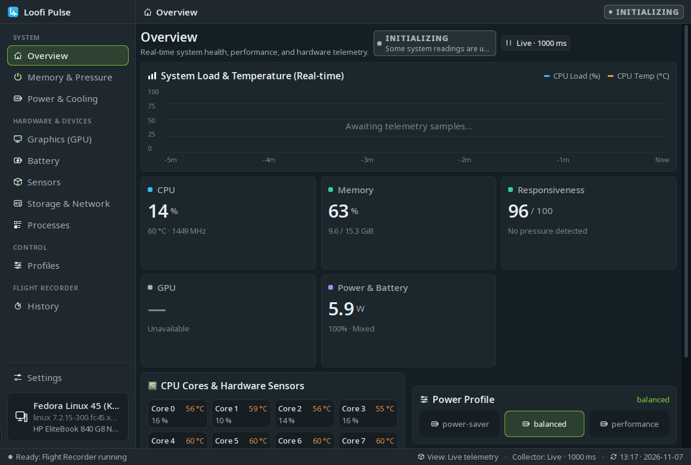
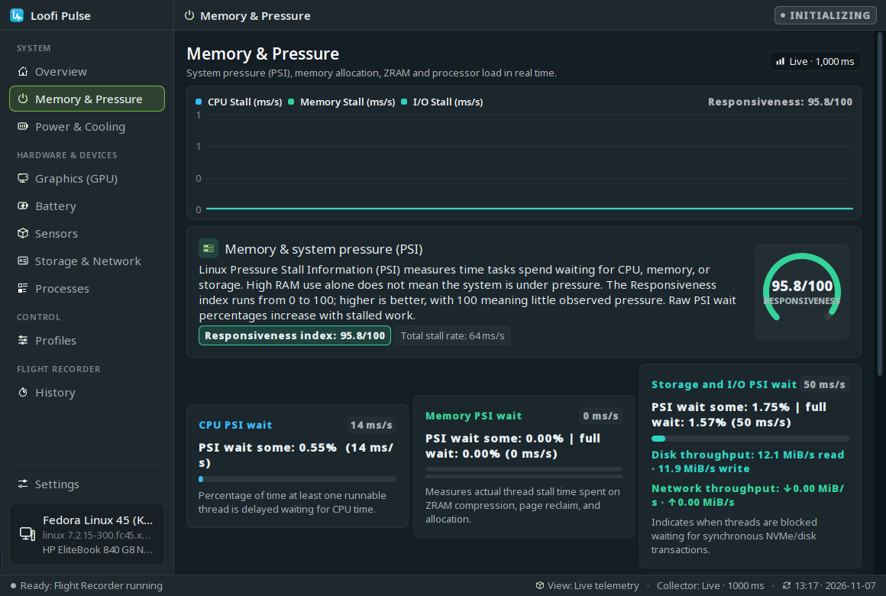
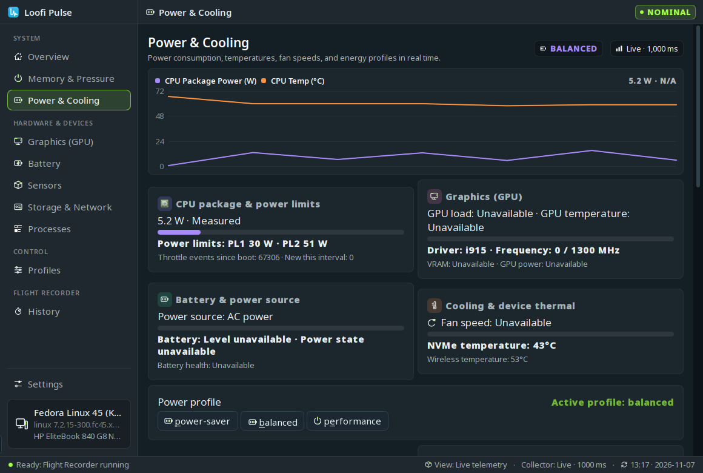
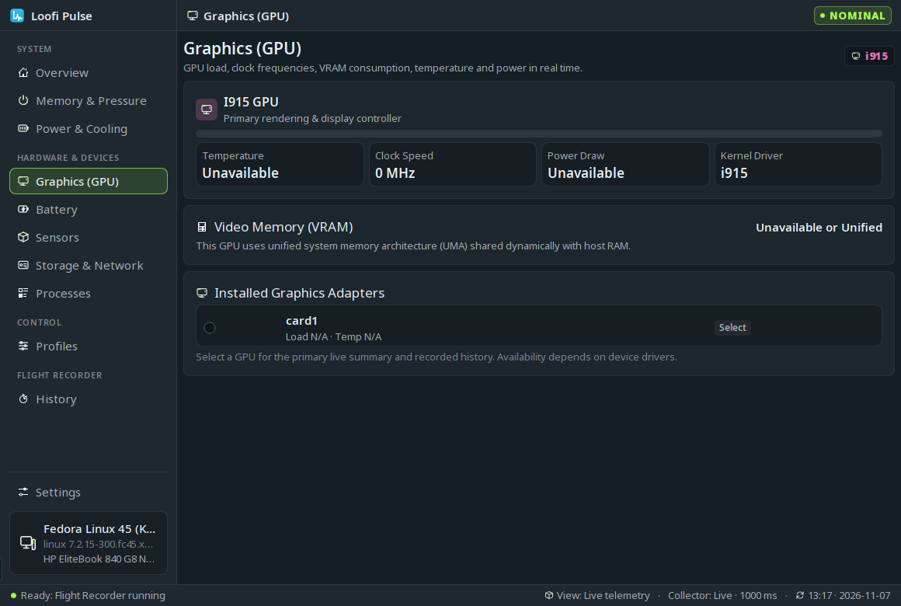
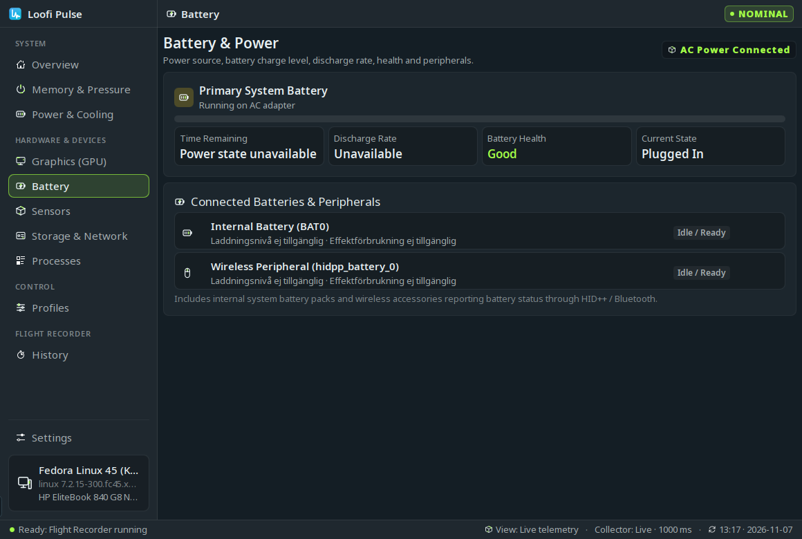
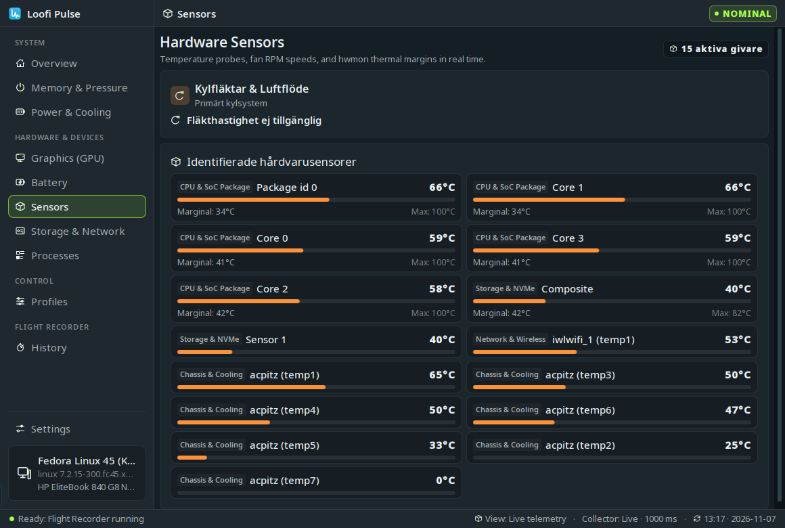
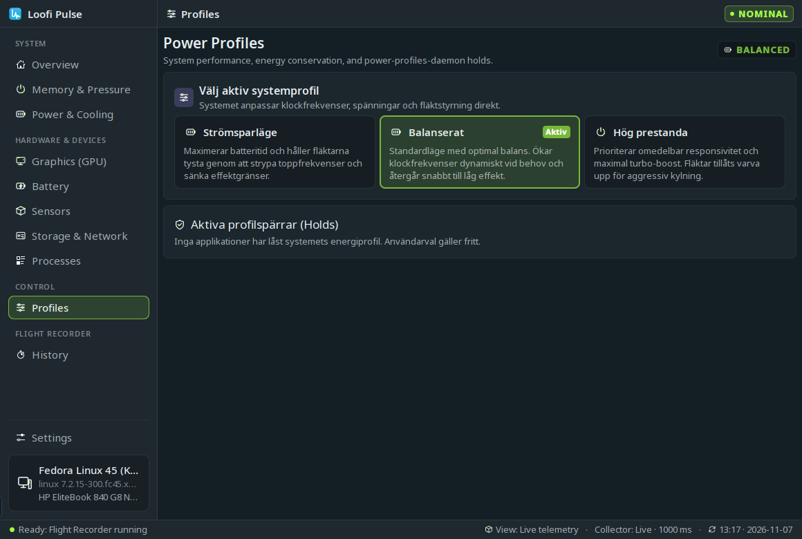
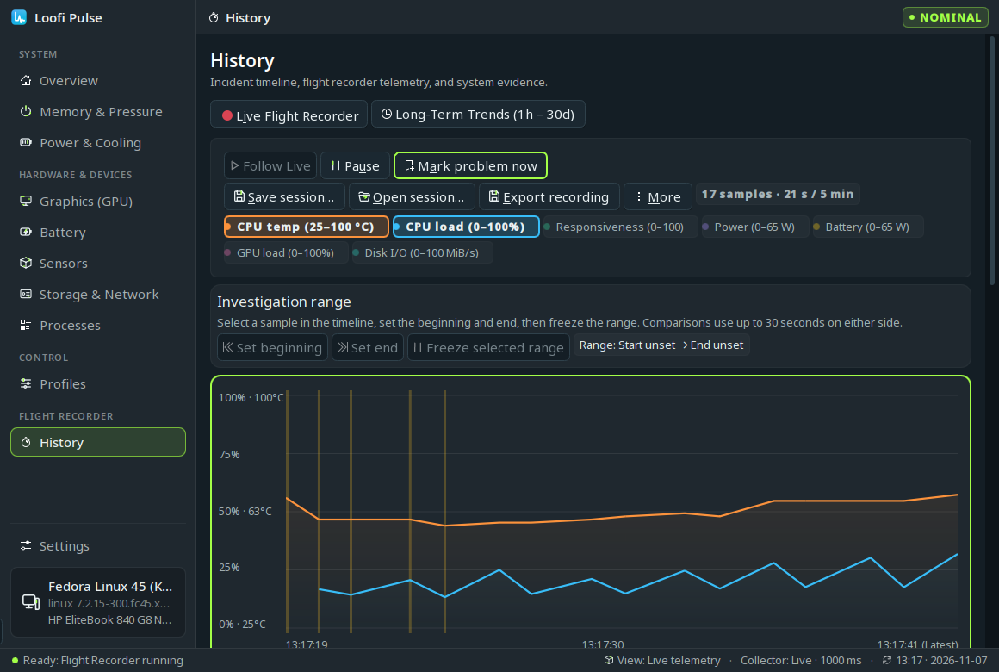
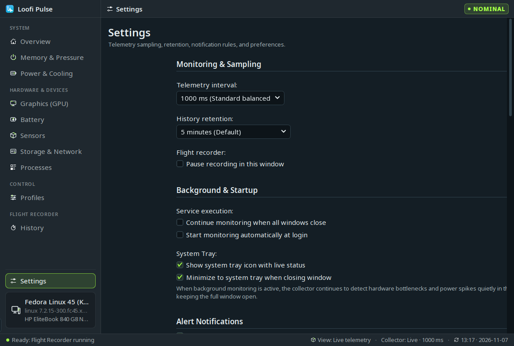

# Loofi Pulse User Guide

Welcome to the comprehensive user guide for **Loofi Pulse**, the next-generation Linux hardware telemetry, PSI stall detection, and flight recorder application for KDE Plasma 6.

---

## Table of Contents

1. [Overview Dashboard](#1-overview-dashboard)
2. [Memory & Pressure (PSI)](#2-memory--pressure-psi)
3. [Power & Cooling](#3-power--cooling)
4. [Graphics (GPU)](#4-graphics-gpu)
5. [Battery & Peripherals](#5-battery--peripherals)
6. [Hardware Sensors](#6-hardware-sensors)
7. [Storage & Network](#7-storage--network)
8. [Processes Radar](#8-processes-radar)
9. [Power Profiles](#9-power-profiles)
10. [Flight Recorder & Incident History](#10-flight-recorder--incident-history)
11. [Settings & Language Preferences](#11-settings--language-preferences)
12. [KDE Plasma 6 Widget](#12-kde-plasma-6-widget)
13. [Keyboard Shortcuts](#13-keyboard-shortcuts)

---

## 1. Overview Dashboard

The Overview page serves as your command center, delivering immediate insight into the physical health and performance of your system without visual clutter.

### Key Components:
- **Status Pill**: Displays real-time status:
  - `NOMINAL` (Green): All hardware parameters are within safe operational limits.
  - `INITIALIZING` (Blue): Telemetry buffers are populating initial sensor baselines.
  - `THROTTLING` (Red): Active hardware thermal or power limits have been engaged by firmware.
- **Dual-Line System Activity Chart**:
  - **Blue line**: Overall CPU load percentage (0–100%).
  - **Orange line**: CPU package temperature (°C).
  - Dynamic y-axis scaling with clean 5-minute historical trend progression.
- **5 Core Telemetry Pillars**:
  1. **CPU**: Load %, current package temperature, and average operating frequency.
  2. **Memory**: RAM utilization %, used vs total GiB, and swap usage.
  3. **Responsiveness (PSI)**: System responsiveness score out of 100 based on Linux kernel Pressure Stall Information.
  4. **GPU**: Active GPU load %, core clock MHz, and board power consumption.
  5. **Power & Battery**: Combined system package wattage, battery charge %, and charging status.
- **Per-Core Grid & Sensor Summary**: Individual CPU core load and temperatures, alongside quick power profile toggles.

---

## 2. Memory & Pressure (PSI)

Linux Pressure Stall Information (PSI) provides honest, kernel-level metrics on resource starvation rather than simple utilization numbers.

### Understanding PSI Metrics:
- **CPU Pressure (`some avg10`)**: Percentage of time that one or more tasks were stalled waiting for available CPU time.
- **Memory Pressure (`some avg10 / full avg10`)**:
  - `some`: Tasks delayed waiting for memory pages (e.g., swapping or disk reclaim).
  - `full`: All non-idle tasks stalled completely due to lack of memory (critical sluggishness).
- **I/O Pressure (`some avg10 / full avg10`)**: Stalls waiting for storage operations to finish.
- **ZRAM Compression Engine**: Real-time ratio, uncompressed data size, compressed payload footprint, and total memory saved.

---

## 3. Power & Cooling

Monitor electrical power consumption, thermal headroom, cooling fans, and dynamic thermal velocity.

### Core Telemetry:
- **RAPL Energy Counters**: Processor package power, PL1/PL2 power limits, and core wattage.
- **Thermal Headroom**: Degrees Celsius remaining before the CPU reaches its critical thermal junction (`TjMax`).
- **Thermal Velocity**: Rate of temperature change in °C per second, allowing proactive throttling anticipation.
- **Cooling Fans**: Active tachometers reporting fan RPM with visual status indicators.

---

## 4. Graphics (GPU)

Dedicated hardware view for discrete and integrated graphics processors (Intel Iris Xe / Arc, AMD Radeon, NVIDIA proprietary & nouveau).

### Displayed Telemetry:
- **GPU Engine Load Arc**: Percentage of active execution units utilized.
- **Core & Boost Clocks**: Current frequency in MHz and rated boost target.
- **VRAM Utilization**: Dedicated video memory usage with visual bar indicator.
- **Multi-GPU Switcher**: Easily switch between integrated and discrete GPUs on hybrid graphics laptops.

---

## 5. Battery & Peripherals

Comprehensive power telemetry for primary system batteries and wireless peripherals.

### Key Features:
- **Charge Rate & Flow**: Positive charging wattage (+) or discharging drain (-).
- **Accurate ETA**: Estimated time remaining until full charge or complete discharge based on rolling power averages.
- **Health & Degradation**: Design capacity vs full charge capacity calculation.
- **Peripheral Device Matrix**: Batteries for Bluetooth mice, keyboards, headsets, and Logitech HID++ devices.

---

## 6. Hardware Sensors

Direct `hwmon` sensor discovery matrix without external polling overhead.

- Grouped by hardware domain: CPU cores, GPU core/junction, NVMe SSD composite temperatures, Wi-Fi chipset, and motherboard ACPI thermal zones.
- Real-time animated fan RPM dials with minimum, current, and maximum observed speeds.

---

## 7. Storage & Network

Per-device storage performance and active network interface telemetry.

### Features:
- **Disk I/O Throughput**: Read/write rates in MiB/s for NVMe, SATA SSDs, and external storage.
- **NVMe Controller Health**: SMART critical warning bitmask decoding (spare capacity, reliability degradation, read-only mode).
- **Network Interfaces**: Real-time throughput (RX/TX), packet drop rates, interface speeds, and Wi-Fi link quality.

---

## 8. Processes Radar

Read-only process inspector focused on system impact and resource culprits.

- **Resource Consumption**: Sorted by CPU %, Resident Set Size (RSS MiB), and Disk I/O.
- **Uninterruptible Disk Wait (State D)**: Pinpoints tasks blocked on disk I/O causing UI stutters.
- **KDE System Monitor Integration**: Direct button to launch KDE System Monitor (`plasma-systemmonitor`) with PID pre-selection.

---

## 9. Power Profiles

Integrated with system `power-profiles-daemon` (PPD) for hardware energy management.

### Available Modes:
1. **Power-saver**: Reduces CPU frequency caps, prioritizes battery longevity.
2. **Balanced**: Standard dynamic governor for everyday performance.
3. **Performance**: Maximizes boost clock durations and cooling aggressiveness.
- Displays active **Profile Holds** from background applications (e.g., game mode or video rendering).

---

## 10. Flight Recorder & Incident History

Loofi Pulse includes a zero-loss circular telemetry buffer that runs continuously in memory.

### Capabilities:
- **Interactive Time Scrubber**: Drag across the timeline to inspect any historical 1-second sample up to 30 minutes in the past.
- **Incident Clustering**: Groups identical repeated warning episodes into clean clusters with `[N×]` multiplier badges.
- **Causal Analysis**: Automatically identifies culprit processes and primary contributing signals during system stalls.
- **Session Export**: Export recordings to standalone `.loofipulse`, Markdown, HTML, or JSON files.

---

## 11. Settings & Language Preferences

Tailor telemetry sampling, retention, alerts, and regional settings.

- **Application Language**:
  - `English (Default)`
  - `Svenska (Swedish)`
  - `Follow System (OS Default)`
- **Telemetry Sampling**: 250 ms (High responsiveness) to 5000 ms (Minimal CPU).
- **History Retention**: 5 minutes, 15 minutes, or 30 minutes in-memory buffer.
- **Quiet Hours**: Suppress incident notifications during scheduled hours.
- **Long-Term History**: Opt-in 1-minute persistent aggregate database with configurable retention (1, 7, 14, 30 days).

---

## 12. KDE Plasma 6 Widget

The companion Plasma widget lives in your desktop panel for glanceable monitoring.

- **Panel Representations**: Text pill, mini sparkline, or circular ring gauge.
- **Compact Popup**: 2x2 key metrics grid, live mini chart, and one-click power profile buttons.
- **Quick Problem Marker**: Instantly bookmark the current timestamp in the Flight Recorder for later analysis.

---

## 13. Keyboard Shortcuts

| Shortcut | Description |
| :--- | :--- |
| `Ctrl+1` / `Alt+1` | Navigate to **Overview** |
| `Ctrl+2` / `Alt+2` | Navigate to **Flight Recorder / History** |
| `Ctrl+3` / `Alt+3` | Navigate to **Memory & Pressure** |
| `Ctrl+4` / `Alt+4` | Navigate to **Power & Cooling** |
| `Ctrl+5` | Navigate to **Processes** |
| `Ctrl+6` | Navigate to **Storage & Network** |
| `Ctrl+,` / `Ctrl+Alt+S` | Open **Settings** |
| `Ctrl+O` | Open saved session file |
| `Ctrl+S` | Save current Flight Recorder session |
| `F1` / `Ctrl+?` | Open Keyboard Shortcuts cheat sheet |
